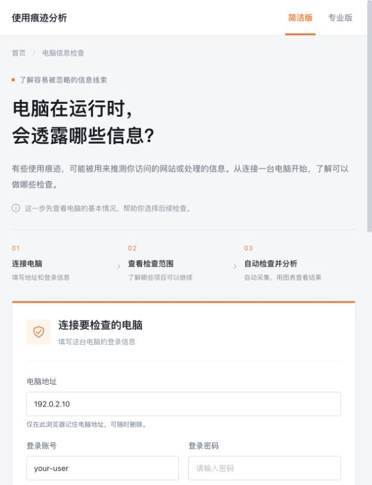
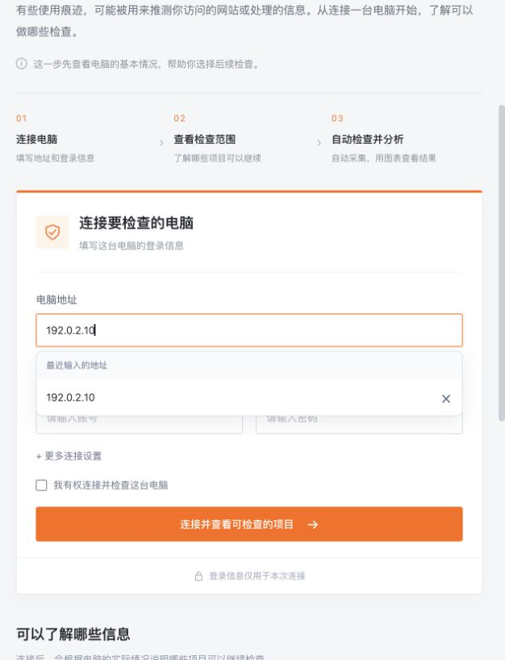
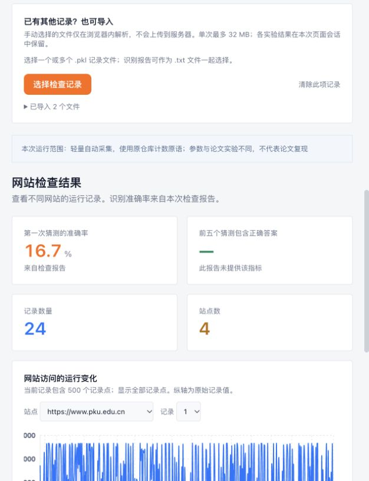

# SegScope · 使用痕迹分析

基于 [SegScope](https://github.com/zhangxin00/segscope) 的 CasOS 应用，用日常语言展示电脑运行痕迹可以透露哪些信息，并把授权实验机上的短时检查结果转为图表。它提供简洁版与专业版、准备度评分，以及 E1–E4 的结果分析。

## 页面预览





## 自动检查

用户填写授权电脑的 SSH 连接信息，点击“开始自动检查”。服务自动传送固定脚本、准备独立运行环境、执行检查、显示进度、校验回传文件，并展示图表；也可停止任务或导入已有文件。

| 项目 | 当前范围 |
| --- | --- |
| E1 网站使用痕迹 | 四个公开网站、每站六条记录；独立沙箱浏览器、自动训练/测试划分、识别报告与矩阵 |
| E2 信息传递情况 | 支持导入与分析；自动执行尚未接入 |
| E3 重要位置保护 | 两轮短时预取测量、512个候选及排名；不读取需要额外权限的真实位置 |
| E4 异常干扰防护 | 原 LLVM 插件在轻量程序上的三种设置比较；不加载内核模块，不验证主动干扰下的防护效果 |

准备度评分表示实验基础条件，不是安全评分。短时实验参数与原论文不同，不能据此声称完整复现或日常环境已经发生信息泄露。

## 运行与安装

使用 [Dockerfile](Dockerfile) 构建镜像，或按 [RELEASE.md](RELEASE.md) 使用 Helm 与 CasOS 模板安装。控制服务在容器内以普通用户65532运行，使用 `/data/jobs` 保存任务；不需要 Docker socket、管理员权限或集群管理凭据。

目标电脑需为 x86_64 Linux，并具备基础编译工具。E1 首次准备需要下载 Python 包和 Chromium，且要求可用的用户级资源限额；E4 需要 clang/opt 18 与 CMake。每次一个任务，远端执行最长20分钟、低优先级、限制内存；不写 MSR，不加载内核模块，不修改全局系统保护设置。

SSH 密码或私钥只用于本次连接，不写入任务存储。电脑地址历史仅保存在当前浏览器，每条右侧的 × 可删除；不会保存账号和密码。任务ID用于访问对应结果，部署入口应限制在授权用户可访问的范围内。

## 开发与验证

```sh
cd apps/segscope-viz
yarn install --frozen-lockfile
python3 scripts/build-runner.py
yarn check:imports
yarn build
go build -o segscope-viz ./server
go vet ./server
SEGSCOPE_ENABLE_JOBS=true ./scripts/run-preview.sh
```

打开 `http://127.0.0.1:5175/`。只运行前端预览不会提供 SSH 或任务接口。

可用环境变量：`SEGSCOPE_ADDR`（容器默认 `:8080`）、`SEGSCOPE_STATIC_DIR`（容器默认 `/app/build`）、`SEGSCOPE_DATA_DIR`、`SEGSCOPE_ENABLE_JOBS`。

验证包含解析器异常输入、地址历史去重与损坏存储、已有完成任务后切换四个项目、地址选择/删除/刷新、真实远端 E1/E3/E4、取消任务及容器启动。

## 基于 SegScope

选定的 SegScope 源码以 MIT 许可证保留在 [third_party/segscope](third_party/segscope)，上游版本与逐文件 SHA256 记录在 [SOURCE.json](third_party/segscope/SOURCE.json)。[NOTICE](NOTICE) 和上游许可证随源码保留，许可证也复制到运行镜像中。新增部分为页面、SSH 任务控制、受限执行脚本与结果解析；不是上游项目的官方产品。
