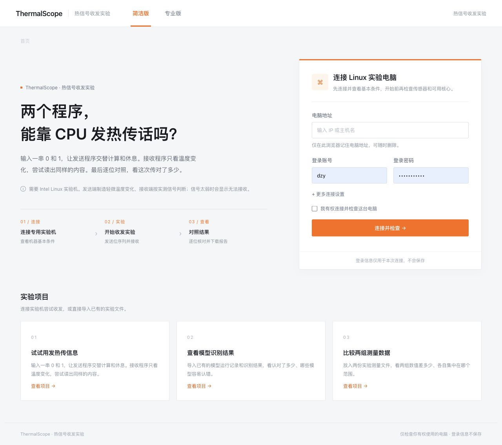
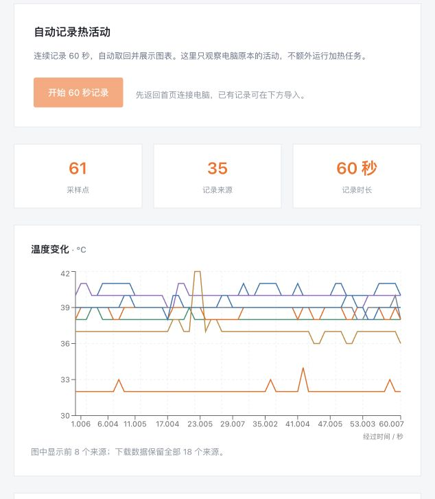

# ThermalScope · 热信号收发实验

**两个程序，能靠 CPU 发热传话吗？** 简洁版连接成功后自动生成 8 位测试内容并开始收发，完成后直接查看结果；专业版可手动输入 1–8 位 0/1。发送程序交替计算和休息，另一个程序只读取 CPU 封装温度，尝试还原，再逐位对照实测结果。温度记录和已有模型、位置测量文件的分析作为辅助工具保留。

这是独立实现的、已知时序和训练前导的温度教学实验。原论文研究热事件中断（TRM），这里不把普通温度信号称为原论文的复现，也不将接收结果当作越过系统隔离的证明。接收程序只得到传感器、起始时刻、时隙长度、前导与负载长度，发送内容在接收程序退出后才加入结果，不能参与阈值计算或修正答案。

本应用暂放在 CasOS 的 `apps/thermalscope`，保持独立构建边界；维护者可按 SegScope 的方式迁移至独立仓库。CasOS 的安装模板位于 `store/builtin/thermalscope.yaml`。

## 收发实验

1. 部署者设置 `THERMALSCOPE_ENABLE_CHANNEL=true`，连接 Intel x86_64 Linux 实验机。默认部署只开启被动记录。
2. 简洁版在连接表单确认使用权限和短时 CPU 实验负载，点击“连接并开始实验”；连接检查成功后自动跳转、生成 8 位内容并启动一次收发。专业版连接后仍需输入 1–8 位 0/1、确认实验负载并手动开始。打开已有结果、切换模式或项目不会重复启动。
3. 发送端在一个核心上以最多 50% 占空比计算来发送 1，休息来发送 0；接收端位于同一封装的另一物理核心，每 0.2 秒读取温度。
4. 先发送已知前导 `0101`，用后半时隙平均温度确定阈值，再解码用户输入。每位 6 秒，共约 31–73 秒。接收端不读取用户输入。
5. 页面展示实测温度、接收到的各位、错误位和未知位。前导无法区分、温度缺失或时序异常会显示无法可靠接收，保留 `?`，不补造答案。接收完成也可能全部错误。

需要可读取的 `coretemp` 封装温度、同一封装内至少两个可用物理核心，以及 Python 3。虚拟机、缺少来源或温度达到 80°C 时不执行或立即停止；传感器读取失败也会停止。任务限制时长和进程数，取消时回收收发子进程。实验不追求触发降频，不改变风扇、功耗、内核或温控设置。散热、传感器刷新和后台活动都可能使接收失败。

共享主机默认只用于构建和被动记录，主动实验需要主机使用者明确授权并确认资源可用。部署者可用 `THERMALSCOPE_CHANNEL_BLOCKED_HOSTKEYS` 配置逗号分隔的 SSH SHA256 指纹，阻止对共享主机发起主动实验（包括通过地址别名连接）。

可导入本应用保存的 `channel-result.json` 复查并下载 JSON / Markdown 报告。模型识别和位置测量入口仍只分析用户提供的已有文件。

## 本地运行

需要 Go 1.22+、Node.js 20+、Yarn Classic、Python 3。以下命令在 `apps/thermalscope` 应用目录中运行。

```sh
yarn install --frozen-lockfile
node scripts/check-imports.mjs
node scripts/check-channel-imports.mjs
python3 scripts/check-channel.py
yarn build
python3 scripts/build-runner.py
go build -o thermalscope ./server
go vet ./server
sh scripts/run-preview.sh
```

打开 <http://127.0.0.1:25176>。预览使用完整 Go 服务，单独的 Vite 静态预览不提供连接和任务 API。`run/jobs/` 保存任务及采集结果，不保存登录密码或私钥。

## 辅助工具：被动记录与已有文件

1. 输入 Linux 电脑地址、普通账号和本次登录凭据，确认你有权记录，点击检查连接。当前按钮仅检查能否记录，不会立即采集。
2. 查看这台电脑能记录什么。可进行自动记录时，启动 60 秒记录；页面显示进度，支持停止，完成后自动取回并展示温度曲线或计数图表。
3. 在相应项目导入已有实验结果，查看图表和统计，下载实际数据及分析报告。后两项不需要连接电脑。

自动记录需要 Intel x86_64 Linux、Python 3，以及至少一个可读取的温度、TRM 热中断或节流计数来源。它只观察现有活动，不运行加热负载，不安装软件、加载模块、写 MSR 或更改系统设置。没有热中断来源时仍可记录其他可用来源，页面和报告会明确区分。

"这台电脑能记录什么"的得分只表示现有来源是否可用，不代表安全或风险。温度以摄氏度显示，计数以相邻采样间隔的增量显示；首次读取、缺失和计数器回退对应空值，不补零。温度变化、节流次数和热中断是不同的量。热中断是处理器报告的温度相关事件；节流计数是系统提供的降频计数，不是频率曲线，不推断实际频率。

## 导入格式

### 信息传递：`send_signal` 与 `receive_signal`

两文件内容为 0/1 字符串，可含空白和换行。必须同时提供，允许长度不同。工具计算原 artifact 使用的 Levenshtein 编辑距离与发送长度之比（编辑距离比例包含插入、删除和替换，可能超过 100%，不等同于逐位误码率），另在等长情况下计算逐位错配率（仅当两组长度相同时才有值）。未提供发送时长时不计算吞吐率。这是与温度记录独立的用途。

### 模型记录：`.pkl` 或 JSON

支持上游采集脚本连续写出的 `(trace, label)` pickle 记录，trace 可嵌套一层列表。解析器仅接受数据操作码，不运行 Python 对象。JSON 格式如下（这里描述结构，不附带示例科研结果）：

```text
{ "traces": [{ "label": "模型名称", "samples": [有限数值, ...] }, ...] }
```

可另外导入 `predictions.json`：

```text
{ "predictions": [{ "actual": "真实标签", "predicted": "预测标签" }, ...] }
```

准确率和混淆矩阵仅来自提供的预测记录。没有预测记录时只展示原始曲线与标签数量，应用本身不识别模型。上游模型采集脚本依赖未包含的 `full3.so` 和本机路径，本版不将其包装成可一键执行的模型复现实验，也不下载 ImageNet 或模型权重。

### 位置测量：`map-count` 与 `unmap-count`

每行一个非负整数，分别代表上游两类位置的测量结果。支持不等长的两组数据，展示数量、分布和中位数差异。上游代码固定比较两个位置并输出重复测量，这不是 SegScope 的 512 个候选位置分析；组间差异不等于成功恢复 KASLR 地址，应用不声称找出内存地址。

### 自动记录：`thermal-trace.json`

由本应用自动产生，包含 `source: "thermal-observation"`、开始时间、采样间隔、来源路径、各采样点和计数重置记录。可重新导入保存的结果。`metadata.json` 保存本次采集范围。自动记录完成并不表示隐蔽信道、模型识别或位置推测已经成功。

## 在 pkusgx 构建与打包

优先在 pkusgx 的独立目录运行（使用普通账号与现有工具）：

```sh
bash scripts/build-release.sh
```

这会生成 Linux amd64 程序、前端和 `release/` 下的标准 Docker/OCI 镜像归档、SHA256 校验和、Helm chart 与 CasOS 模板，无需启动 Docker 或申请 Docker 管理权限。Docker 归档可由具备容器管理权限的部署环境执行 `docker load -i release/thermalscope-0.1.0-linux-amd64.docker.tar` 导入；归档校验通过不等于已进行容器运行验证。

## 部署

```sh
docker build -t thermalscope:0.1.0 .
docker run --rm -p 127.0.0.1:25176:8080 \
  --read-only --cap-drop ALL --security-opt no-new-privileges \
  -v thermalscope-data:/data thermalscope:0.1.0
```

镜像以 UID/GID 65532 运行，只写 `/data`，不挂载 Docker socket 或 Kubernetes 管理凭据。控制容器通过 SSH 连接实验电脑，容器自己的温度和计数不作为远程实验结果。

`chart/` 提供 Helm 安装；`marketplace/thermalscope/index.yaml` 提供 CasOS 模板。两者要求显式填写你构建并发布的完整镜像地址，未预设不存在的公共镜像。

```sh
helm lint chart --set image=YOUR_REGISTRY/thermalscope:0.1.0
helm template thermalscope chart --set image=YOUR_REGISTRY/thermalscope:0.1.0
helm install thermalscope chart --set image=YOUR_REGISTRY/thermalscope:0.1.0
```

默认只在本机监听；容器配置监听 8080，面向已授权的实验室内网使用。对外接入时应由部署入口提供身份认证。活动任务最多一个，历史任务最多 20 个。任务 ID 是随机访问凭据，不应对外分享。取消只处理本任务的进程；服务器重启后未完成任务标为中断，并为远端超时退出保留等待时间。

主要配置：

| 环境变量 | 用途 |
| --- | --- |
| `THERMALSCOPE_ADDR` | 监听地址，本地默认 `127.0.0.1:25176` |
| `THERMALSCOPE_STATIC_DIR` | 前端构建目录 |
| `THERMALSCOPE_DATA_DIR` | 任务结果目录 |
| `THERMALSCOPE_ENABLE_JOBS` | 设为 `true` 启用远端任务 |
| `THERMALSCOPE_ENABLE_CHANNEL` | 另设为 `true` 启用主动热信号收发，默认关闭 |
| `THERMALSCOPE_CHANNEL_BLOCKED_HOSTKEYS` | 禁止主动实验的 SSH SHA256 指纹，多个以逗号分隔 |

## 镜像发布

平台根目录的 `.github/workflows/thermalscope-image.yml` 在相关 PR 中执行非发热检查、构建和容器启动验证；合入 master 后才发布 `ghcr.io/<仓库所有者>/thermalscope`，标签为 0.1.0 与 latest。首次发布后需要确认包的访问权限。在发布完成前，安装模板仍要求填写实际可拉取的镜像地址。

## 本次验证

已在 pkusgx 完成 Linux amd64 构建、Go 静态检查与前端生产构建，并生成和验证 Docker/OCI 镜像归档。使用真实机器完成 60 秒被动记录，返回 61 个采样点，温度、TRM 与节流计数分别展示。取消、主机身份变化、未完成产物拒绝和服务重启恢复均已检查。

浏览器已验证三类文件导入、跨项目与模式切换、报告实际下载。解析验证覆盖 Python 标准 pickle 协议 2–5、恶意对象操作码、非有限数、插入/删除、共同比较区间和实际后端字段。离线功能验证使用独立合成输入；它们不是产品默认数据。

镜像归档已校验结构和摘要；尚未在容器运行时导入启动，也未发布公共镜像或上架 CasOS。





## 来源与许可

应用代码使用 Apache-2.0；通用界面和 SSH 任务基础设施参考 [CasOS SegScope](https://github.com/casosorg/segscope)。研究依据为 Xin Zhang 等发表于 DAC 2024 的 *ThermalScope: A Practical Interrupt Side Channel Attack Based On Thermal Event Interrupts*，[官方 artifact](https://github.com/zhangxin00/ThermalScope) 核对版本为 `43ff9efaa6ac77fe3fe2d1dfcc1efd15d162db53`。

该上游版本未附带许可证文件，因此本应用不重新分发其 C 程序、模型或图像。来源文件摘要见 `docs/upstream-review.json`，详情见 `NOTICE`。本应用的独立温度收发教学实验、被动观察与离线分析不代表原论文热中断信道的复现。
