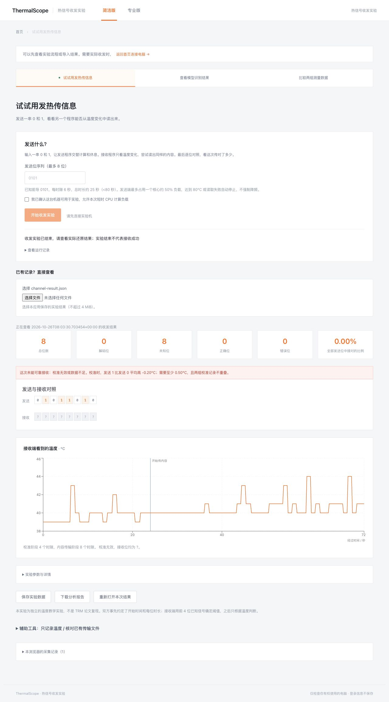

# 热信号收发验证（2026-10-26）

主流程是独立的温度信号收发教学实验，原温度记录和文件分析保留。接收端只得到传感器、时序、已知前导和内容长度；用户发送的内容在解码结束后才用于对照。

用户明确授权在 pkusgx 检查负载和温度后运行一次完整实验。开始前 32 个逻辑核心，负载约 2，封装温度约 37°C。CPU 0/1 位于同一封装。单核心最多约 50% 负载，时隙 6 秒，前导 0101，运行约 73 秒，没有改变系统温控等设置。

| 项目 | 实测结果 |
| --- | --- |
| 发送 / 接收 | 01011010 / ???????? |
| 采样 | 360 个点，39–44°C |
| 校准 0 / 1 均温 | 39.83 / 39.63°C |
| 校准温差 | −0.20°C |
| 状态 | inconclusive，未可靠接收任何位 |

不能将温度波动或流程完成称为成功通信。普通温度教学实验不是原论文的 TRM 热中断复现；没有按发送内容补齐答案。

已通过：pkusgx Go 构建、vet、go test（无 Go 测试文件，未新增）；Vite 生产构建；原有及新增 JS 导入检查；24 项非发热 Python 检查；本地轻量 ESLint；真实 SSH/API 的授权、负载确认、参数上限、root/未知实验/并发拒绝、首个休息时隙取消、未完成结果拒绝；部署关闭 503、受保护指纹 403；无残留收发进程和持久化凭据；浏览器真实结果导入、任务链接取回、首次结果显示、模式/项目切换、Markdown 下载；Helm/CasOS 模板验证；diff 空白检查。

Docker/OCI 归档已在 pkusgx 更新，结构和校验和已验证，容器导入/启动未验证。前端约 593 KB，保留 Vite 大包提示。80°C/失效停止分支通过非发热检查验证，未人为制造过热。稳定通信未验证，没有发布仓库或镜像。

## 简洁版自动发送交互验证

简洁版不再显示发送序列输入、实验页授权复选框或手动开始按钮。连接表单的一次确认明确包含连接后自动开始短时实验。专业版保留手动流程。

使用 pkusgx 生产构建和本地独立测试后端验证（仅返回测试用响应，无 SSH 和发热负载）：简洁版成功连接只提交一次随机 8 位内容；切换模式/项目不重发；专业版连接后不自动提交；启动失败只尝试一次；不支持的硬件不提交。ESLint、已有 JS 检查和前端构建通过。既有真实实验结果仍可打开，未为此次 UI 调整额外运行发热实验。

## 发布准备与本地清理（2026-10-27）

在 pkusgx 重跑完整发布构建、Go build/vet/test、前端构建和现有解析检查，通过；镜像摘要校验通过。从 Docker 归档提取同一根文件系统，用已有 bubblewrap 以 UID65532、只读根、移除能力和可写数据目录隔离运行，健康接口与静态页面通过，主动实验默认关闭。Docker 服务无访问权限，rootless runc 受用户映射限制，不能把根文件系统检查称为 Docker/OCI 直接启动验证。新增 GitHub Actions 会在相关 PR 中构建并用 Docker 验证容器启动，master 合入后才发布 thermalscope 镜像。
